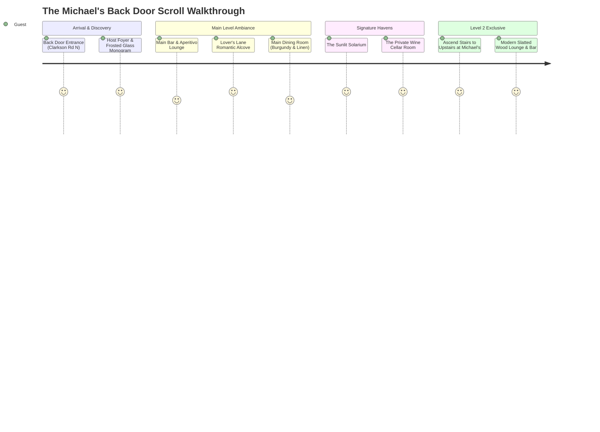

# Michael's Back Door Restaurant — Architectural Floor Plan & 3D Walkthrough Specification

> **Purpose:** Blueprint and spatial layout specification for the interactive 3D scroll-driven restaurant walkthrough.  
> **Status:** Pending User Confirmation  
> **Location:** 1715 Lakeshore Rd W, Mississauga, ON (Entrance via Clarkson Rd N rear alley)  

---

## 1. Spatial Structure & Building Overview

Michael's Back Door has a distinctive layout that evolved over 44 years through the integration of multiple historic commercial spaces in Clarkson Village. Rather than a monolithic banquet hall, it is an interconnected sequence of intimate dining environments, each with its own material palette, acoustic character, and lighting signature.

The building is structured over **two levels**:
- **Ground Floor (Main Level):** The arrival sequence, Bar & Lounge, Lover's Lane alcoves, Main Dining Room, The Solarium, The Private Wine Room, Kitchen, and Garden Patio.
- **Level 2 (Upstairs at Michael's):** A secluded private event and cocktail lounge with a dedicated bar, acoustic wood slat walls, private restrooms, and flexible seating.

```
       [ LAKESHORE ROAD WEST - Historic Street Frontage ]
       ==================================================
       [ Private Wine Room ]   [ The Solarium ]
       [ (10-18 guests)    ]   [ (30-42 guests, Skylight) ]
       --------------------------------------------------
       [ Main Dining Room (Burgundy Walls & Sconces)   ]
       --------------------------------------------------
       [ Lover's Lane ]   [ Main Bar & Lounge ]   [ Stairs to Level 2 ]
       [ (Intimate 2-top) ] [ (Pendant lighting) ] [ Upstairs at Michael's ]
       --------------------------------------------------
       [ Kitchen & Pass ] [ Host Foyer / MBD Glass ] [ Restrooms ]
       ==================================================
       [ THE "BACK DOOR" ENTRANCE & PARKING LOT ]
       [ (Off Clarkson Road North)              ]
```

---

## 2. Room-by-Room Spatial Breakdown

### Ground Level (Main Floor)

#### 1. The Secret Back Door Entrance & Vestibule
* **Location:** South-west rear entrance facing the Clarkson Rd N parking lot.
* **Key Visuals:** Weathered brick exterior, brass lantern, iconic dark walnut door with four raised panels and fanlight transom, glowing amber interior light.
* **Guest Arrival Experience:** Guests step off the quiet rear parking lot into a warm, candlelit foyer, evoking the speakeasy discovery that defines the brand.
* **Asset Reference:** `assets/logos/michaels-back-door-logo-glowing-gold.png`, `assets/logos/michaels-back-door-door-mark.png`

#### 2. The Host Foyer & Monogram Threshold
* **Location:** Immediately inside the back door.
* **Key Visuals:** Host greeting podium, coat check, vertical frosted glass partition etched with the heritage **"M B D"** monogram, warm golden bokeh candlelight reflecting through the glass.
* **Flow Connection:** Leads directly forward to the Main Bar & Lounge, or right toward the staircase ascending to Level 2.
* **Asset Reference:** `assets/logos/michaels-back-door-monogram-frosted-glass.jpg`

#### 3. The Main Bar & Lounge
* **Location:** Central hub between the foyer and the main dining rooms.
* **Key Visuals:** Dark mahogany bar counter with brass footrail, illuminated back-bar bottle display featuring Italian aperitivi (Campari, Aperol), blown amber glass cylinder pendant lights (`2700K`).
* **Capacity:** 12 bar stools + 16 lounge cocktail seats.
* **Vibe:** Lively, conversational, pre-dinner cocktails, and after-dinner digestivi.
* **Asset Reference:** `assets/interior_and_ambience/bar-bottles-campari-blown-glass-pendants.jpg`, `assets/interior_and_ambience/bar-and-cocktail-station.jpg`

#### 4. "Lover's Lane" (Romantic Dining Alcove)
* **Location:** Tucked along the western wall adjacent to the bar and main dining entrance.
* **Key Visuals:** Intimate two-top banquette tables, dim candlelight, velvet pillows, draped divider curtains providing acoustic and visual privacy.
* **Capacity:** 3 private 2-top tables (6 guests total).
* **Vibe:** Highly sought-after for anniversaries, proposals, and romantic date nights.
* **Asset Reference:** `assets/interior_and_ambience/table-setting-olive-oil-wine-glasses.jpg`

#### 5. The Main Dining Room
* **Location:** Core central dining salon of the restaurant.
* **Key Visuals:** Deep heritage burgundy walls, warm glowing brass sconces, dark walnut moldings, double-draped crisp white linen tablecloths, crystal glassware, oil cruets, polished herringbone hardwood floors.
* **Capacity:** 45 to 55 seated guests across flexible table configurations (2-tops, 4-tops, and family banquets).
* **Vibe:** Classic 1981 European elegance, bustling, celebratory, timeless fine dining.
* **Asset Reference:** `assets/interior_and_ambience/main-dining-room-burgundy-sconces.jpg`, `assets/interior_and_ambience/dining-table-flatlay-herringbone-floor.jpg`

#### 6. The Solarium
* **Location:** East wing extension looking out toward landscaped gardens and Clarkson Village.
* **Key Visuals:** Floor-to-ceiling glass atrium skylight roof, double French doors opening to an ornamental wrought iron balcony railing, white linen tables, flooded with natural daylight by day and starlight/candlelight by night.
* **Capacity:** 30 to 42 guests (Private buyout) or 16 to 22 guests (Semi-Private configuration).
* **Vibe:** Luminous, airy, romantic; the most popular space for daytime bridal/baby showers, weddings, and milestone dinners.
* **Asset Reference:** `assets/interior_and_ambience/solarium-dining-room-sunlight.jpg`, `assets/interior_and_ambience/solarium-french-doors-and-balcony.jpg`

#### 7. The Private Wine Room
* **Location:** North-west private chamber adjacent to the main dining room.
* **Key Visuals:** Dedicated private room lined floor-to-ceiling with custom dark wood wine racks showcasing 150+ international and Italian vintages (Caymus, Gaja, Antinori, Barolo), central solid walnut dining table, private sound system.
* **Capacity:** 10 to 18 seated guests.
* **Vibe:** Secluded, elite, sommelier-driven; ideal for executive board dinners, private family celebrations, and VIP tastings.
* **Asset Reference:** `assets/interior_and_ambience/wine-room-private-dining-table.jpg`, `assets/interior_and_ambience/wine-cellar-bottle-racks.jpg`, `assets/interior_and_ambience/wine-cellar-wall-perspective.jpg`

#### 8. The Commercial Kitchen & Pass
* **Location:** South-west service wing behind the bar.
* **Key Visuals:** Stainless steel hot line, sauté station where Chef Mark D'Souza plates the Capelli D'Angeli and Linguine Pescatore, pastry station for Tiramisu and molten cakes.
* **Vibe:** Culinary craft, theatrical flambéing, scratch-made pasta production.
* **Asset Reference:** `assets/culinary_and_dishes/capelli-dangeli-lobster-angel-hair-wide.jpg`, `assets/culinary_and_dishes/fresh-pasta-ravioli-craft.jpg`

---

### Level 2 (Upstairs at Michael's)

#### 9. Staircase & Private Upper Landing
* **Location:** Dedicated architectural staircase ascending from the foyer/bar zone.
* **Key Visuals:** Polished oak stairs, subtle recessed wall foot-lighting, framed historical photographs of Michael Morra Sr. and celebrity diners (e.g., Tony Bennett).

#### 10. "Upstairs at Michael's" Event Salon & Lounge
* **Location:** Entire second-floor private wing.
* **Key Visuals:** Contemporary interior renovation: vertical slatted acoustic oak and walnut timber wall paneling, fluted matte black bar facade with stone countertop, brushed brass bird lamps, fluted charcoal leather armchairs, private dedicated bar, private washrooms.
* **Capacity:** 20 to 42 seated guests (or up to 50 for cocktail receptions).
* **Vibe:** Contemporary, chic, exclusive; distinct from the classical burgundy main floor, offering a sleek lounge aesthetic for private corporate dinners and parties.
* **Asset Reference:** `assets/interior_and_ambience/upstairs-at-michaels-wood-slat-lounge.jpg`, `assets/interior_and_ambience/dining-table-wood-slat-feature-wall.jpg`, `assets/interior_and_ambience/interior-decor-olive-branches-brass-lamp.jpg`

---

## 3. The 3D Scroll Walkthrough Camera Sequence

When the user scrolls through the website, the virtual camera follows a cinematic first-person journey through the restaurant, transitioning seamlessly between spaces.



### Camera Keyframe Specifications:

| Scroll % | Camera Stop / Scene | Focal Point / Angle | Atmospheric Effect | UI Overlay Card |
| :--- | :--- | :--- | :--- | :--- |
| **0% – 12%** | **Stop 1: The Secret Back Door** | Exterior rear parking -> slow dolly toward the glowing door with brass knob | Dusk evening sky, warm amber door lantern glow (`#F5A623`) | *"Mississauga's Hidden Gem Since 1981 — Enter through the back door"* |
| **12% – 25%** | **Stop 2: The Host Foyer** | Door swings open into warm foyer, framing the frosted glass **"M B D"** monogram | Warm bokeh candlelight, soft Italian jazz audio cue | *"44 Years of Italian Hospitality — Welcome to Michael's"* |
| **25% – 38%** | **Stop 3: The Main Bar & Lounge** | Glide past polished mahogany bar, amber blown-glass pendants, and Campari display | Amber glass caustics, soft cocktail shaker clink | *"L'Aperitivo Italiano — Handcrafted cocktails & vintage amari"* |
| **38% – 50%** | **Stop 4: Lover's Lane Alcove** | Subtle camera pan into the romantic 2-top corner with candlelight and folded linen | Candle flicker, intimate warm shadows | *"Lover's Lane — Clarkson's most romantic date night table"* |
| **50% – 64%** | **Stop 5: The Main Dining Room** | Sweep across burgundy dining room, white tablecloths, crystal glassware | Warm brass sconces, celebratory hum of conversation | *"The Main Salon — Heritage fine dining, prime veal & scratch pasta"* |
| **64% – 76%** | **Stop 6: The Solarium** | Glide into glass atrium; natural light cascades from the skylight and French doors | Soft volumetric light rays, garden greenery through glass | *"The Solarium — 30 to 42 guests under the stars or afternoon sun"* |
| **76% – 88%** | **Stop 7: The Private Wine Room** | Enter private room surrounded by 150+ vintage wine bottles and sommelier table | Rich walnut wood reflections, crystal decanters | *"The Wine Room — Sommelier-curated private dining for 10 to 18"* |
| **88% – 100%** | **Stop 8: Upstairs at Michael's** | Ascend stairs into the sleek contemporary wood-slatted private lounge and bar | Modern linear lighting, brushed brass accents, fluted bar | *"Upstairs at Michael's — Modern private dining for 20 to 42"* |

---

## 4. Technical Strategy for the 3D Scroll Build

To ensure lightning-fast performance, zero lag, and 60fps scrolling on both mobile and desktop without heavy 100MB 3D model downloads:

1. **Hybrid 2.5D / Three.js Volumetric Projection:**
   - Use high-fidelity spatial depth maps constructed from our authentic high-res interior photography.
   - Parallax layers (foreground tables, middle-ground architectural arches, background windows) creating true 3D spatial depth.
2. **Interactive Architectural Mini-Map:**
   - A persistent, sleek floor plan compass in the corner of the screen that tracks the user's live position and viewing cone as they scroll.
3. **Direct Jump Navigation:**
   - Users can click any room on the mini-map to instantly glide the scroll camera to that destination.
4. **Room Capacity & Booking Action Drawer:**
   - Each stop reveals an expandable glassmorphism drawer with room capacities, menus, and an instant **"Reserve This Room"** or **"Book a Table"** button.

---

*Floor plan blueprint drafted for user review. Once confirmed, 3D asset generation and scroll rigging commence.*
